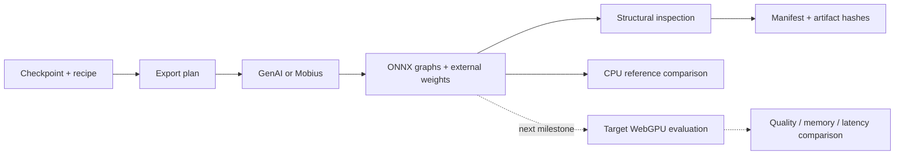

# Design and next milestones

## Scope

Evo owns its Python API, CLI, recipes, exporter invocation, inspection, provenance, and
eventually comparisons on a target runtime. It delegates architecture-specific
ONNX construction to GenAI/Mobius and should delegate complex optimization
workflows to Olive. There is no blanket promise to export every existing model.

## Evidence contract

| Evidence | Initial implementation | Meaning |
| --- | --- | --- |
| Export | Actual subprocess, log and exit status | Upstream exporter completed and produced ONNX. |
| Structure | ONNX checker and external-file checks | Serialized graph passes structural checks; custom-op kernels are not checked. |
| Accuracy | Optional CPU comparison to supplied NPZ | Agreement for those inputs/outputs and tolerances only. |
| WebGPU execution | Native GenAI and raw ONNX profiling implemented | Tested on RTX 5080 with the pinned plugin. |
| Performance | Native generation benchmarks implemented | Repeated, synchronized token observations; see measured workload limits. |

`evo-manifest.json` records the state at export time. Later standalone CPU reports
are separate evidence; they do not silently update a manifest. A future result
store should link all reports by graph hash and reference-dataset identity.

## Next: qualify one real model

The selected first checkpoint is **Qwen/Qwen3.5-4B**. Its reviewed revision is
`851bf6e806efd8d0a36b00ddf55e13ccb7b8cd0a`. The first workload is **text generation
on native ORT WebGPU**. Qualify the GPU, runtime build and quality tolerance. The included
Qwen2.5 0.5B and BERT recipes are secondary examples. See the
[Qwen3.5-specific plan](models/qwen35-4b.md).

1. Export an FP16 baseline and INT4 candidates, initially varying block size only.
2. Match tokenizer/processor versions and input, mask, position, cache and output
   names. Compare original-framework outputs and multi-step generation. Include
   empty/nonempty cache, short/long prompts and representative quality samples.
3. Load each graph with the exact target ORT build. Record operator partitioning
   and fallback, validate results there, and fail qualification if required GPU
   kernels are missing. Do not confuse successful CPU comparison with this gate.
4. Measure load/initialization, first-token latency, prefill throughput, decode
   throughput, file size, and GPU memory where supported. Separate download,
   shader compilation and warm runs. Use repeated samples and report median and
   tail values, with prompt/generated token counts, batch/context sizes and
   browser/runtime/driver/device versions.
5. Compare only candidates that meet the same quality constraints and workload.
   Select a tradeoff rather than asserting universal optimality.

## Native runner contract

Use matching native ORT/GenAI WebGPU packages in a runtime environment, separate
from CPU export dependencies. Load the generated GenAI configuration, preserve
its hybrid-state bindings and provider options, and verify actual WebGPU
execution. The selected model's native generation loop must reset convolution,
recurrent and KV state between requests. Measure prefill and decode separately
and validate results against the original model before tuning.

The native runtime selected the NVIDIA GeForce RTX 5080, recorded in benchmark
and profiling artifacts. See [the measured comparison](qwen35-results.md).

## Possible later browser runner

Use the `onnxruntime-web/webgpu` entry point and serve graphs/weights over HTTP.
Supply `externalData` entries whose `path` matches each graph's recorded
external `location`. Check `navigator.gpu`, `shader-f16` when applicable and
device storage-buffer limits. Account for memory copies and total weight/cache
memory, not only the protobuf size.

Provide model-specific input fixtures and generation/cache bindings. Reuse
GPU-resident KV caches and consume or synchronize outputs when timing; measuring
only queued work is misleading. Profile actual EP placement and fallback.
Try graph capture only after normal execution works, with the required shape,
buffer and kernel conditions, and verify identical outputs.

Browser and native results must remain distinct.

## Extension boundaries

- Add model-specific recipes and validation fixtures before expanding the generic
  schema. Keep precision, activation type and quantization policy distinct.
- Add an Olive adapter when a concrete calibrated workflow is selected. Preserve
  its pass versions, evaluation data, output graph selection and search results.
- Pin HF revisions automatically and fingerprint local checkpoint inputs in a
  future provenance revision. Current output hashes alone cannot reproduce
  a build from a moving HF branch.
- Add GGUF and already-ONNX optimization only with explicit fidelity and quality
  checks; preserving a quantization label does not prove preserved numerics.
